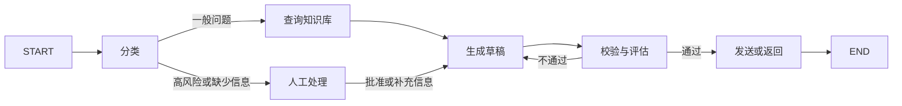

[Open in Notion](https://app.notion.com/p/LangGraph-3211a3b433fe80019b62d5bd52b9e979)


# LangGraph 架构原理与适用场景详解

> **资料基线**：按 2026-11-18 的 LangGraph 官方 Python 文档整理。LangGraph API 持续演进，实施时应核对安装版本对应的文档与 Changelog。

LangGraph 是一个用于编排有状态 Agent 和工作流的运行时。它把程序表达为共享状态、节点和边：节点执行模型调用或普通代码，边决定下一步，状态保存跨步骤传递的数据。它最有价值的地方，是让分支、循环、并行、暂停、恢复和错误处理变成明确可管理的流程。

- *是否需要 LangGraph，取决于流程是否需要被显式编排。**如果只是“接收问题 → 调用模型 → 返回回答”，或一个简单工具循环，通常不需要。若流程会分支、等待人工审批、跨较长时间恢复、并行执行或需要逐步追踪状态，LangGraph 就更有用。

## 1. LangGraph 是什么


LangGraph 的官方定位是**面向长时间运行、有状态 Agent 的低层级编排框架和运行时**。它不负责规定你的 Prompt、Agent 角色或任务策略，也不要求你使用 LangChain。你可以用任意模型客户端和普通 Python 函数编写节点，再由 LangGraph 管理状态变化和控制流。[LangGraph Overview](https://docs.langchain.com/oss/python/langgraph/overview)


可以把它理解为：

- **LLM**负责生成、分类、提取或判断；
- **业务代码**负责查询数据、调用 API 和执行确定性规则；
- **LangGraph**负责决定这些步骤以什么顺序执行、如何分支、状态如何传递、失败后如何恢复。

LangGraph 本身不是模型，也不是开箱即用的完整 Agent 产品。选择 LangGraph 不会自动让模型更准确，也不会自动提供工具权限、安全策略、业务数据库或 UI。


## 2. LangChain、LangGraph 与 Deep Agents 的关系


| 名称          | 主要职责                            | 适合用来做什么                         |
| ----------- | ------------------------------- | ------------------------------- |
| LangChain   | 较高层的模型、工具和 Agent 抽象及集成          | 快速构建通用 Agent，连接模型和工具            |
| LangGraph   | 有状态流程编排和运行时                     | 精细控制状态、步骤、分支、持久化和人工介入           |
| Deep Agents | 构建在 LangGraph 之上的 Agent Harness | 需要内置计划、文件系统工具、上下文管理或子 Agent 等能力 |
| LangSmith   | 追踪、评测、提示管理及部署平台                 | 观察与管理 Agent 运行；与框架解耦的周边平台       |


LangChain 的 Agent 实现建立在 LangGraph 原语之上；需要更细粒度控制时，可以直接使用 LangGraph。官方也将 Deep Agents 描述为建立在 LangGraph 之上的 Agent Harness。[LangGraph Overview](https://docs.langchain.com/oss/python/langgraph/overview) [LangChain Learn](https://docs.langchain.com/oss/python/learn) [Deep Agents Overview](https://docs.langchain.com/oss/python/deepagents/overview)


## 3. 核心心智模型：State、Node、Edge


### 3.1 State：流程共享的数据


State 是一次图执行期间节点共享的结构化状态。它通常包含输入、分类结果、检索结果、草稿、审批结果和执行信息等。


建议在 State 中保存**后续节点需要的原始数据和结果**，而不是保存重复派生值。例如保留原始用户问题、结构化分类、检索结果和待审批草稿；Prompt 字符串可以由节点按需组装。这样修改 Prompt 时不用同时迁移状态格式。[Thinking in the Graph API](https://docs.langchain.com/oss/python/langgraph/thinking-in-graph-api)


### 3.2 Node：执行一个工作单元


Node 是一个读取当前 State、执行工作并返回局部状态更新的函数。它可以：

- 调用 LLM 做分类、生成或判断；
- 调用数据库、搜索 API 或业务服务；
- 执行确定性计算和校验；
- 发起人工审批或等待用户补充信息。

节点最好有清楚的输入、输出和副作用边界。将外部 API 写操作单独做成节点，能更容易设置超时、重试、审计和幂等策略。


### 3.3 Edge：定义流程下一步


Edge 表示执行转移：

- **固定边**：某节点完成后总是到下一个节点；
- **条件边**：根据 State 或路由函数动态选择下一节点；
- **动态发送**：根据当前输入生成一组节点调用，常用于并行扇出；
- **Command 路由**：节点在更新 State 的同时决定下一节点或恢复位置。

简言之：**节点做事，边决定下一步。**[Graph API Overview](https://docs.langchain.com/oss/python/langgraph/graph-api)


## 4. 一次图执行如何运行





调用方把初始输入交给已编译的图。运行时在图内推进节点；节点完成后写入 State，触发后续边。图可通过 `invoke()` 获取最终结果，也可以通过 `stream()` 或新的事件流接口查看过程输出。图在编译时可以附带 Checkpointer、Store 和其他运行配置。[Graph API Overview](https://docs.langchain.com/oss/python/langgraph/graph-api) [Streaming](https://docs.langchain.com/oss/python/langgraph/streaming)


底层以 super-step 推进：同一层可并行执行的节点在一个 super-step 中运行，顺序依赖则进入后续 super-step。所有节点都结束且没有待处理消息时，本次运行结束。[Graph API：Super-steps](https://docs.langchain.com/oss/python/langgraph/graph-api)


### 4.1 常见的工作流模式


LangGraph 可以表达确定性流程，也可以把模型决策和代码路径组合起来。常见模式包括：[Workflows and Agents](https://docs.langchain.com/oss/python/langgraph/workflows-agents)


| 模式                   | 典型结构                          | 适用任务                      |
| -------------------- | ----------------------------- | ------------------------- |
| 顺序链                  | 节点依次执行，后一步使用前一步输出             | 文档翻译、分阶段生成、生成后校验          |
| 路由                   | 分类节点决定走哪条专用路径                 | 客服意图分类后进入账单、退货或技术支持流程     |
| 并行化                  | 多个独立节点并发，最后汇总                 | 同时查多个数据源，或从不同维度评审同一内容     |
| Orchestrator-Workers | 编排节点动态拆任务，Workers 并行执行，汇总节点合并 | 任务数量或子任务内容运行时才可确定的报告、代码修改 |
| Evaluator-Optimizer  | 生成、评估、带反馈重写，直到通过或达到上限         | 有明确质量标准、需要多轮改进的翻译或内容生成    |
| Agent Loop           | 模型决定是否调用工具；工具结果回到模型，直到结束      | 模型需要根据观察动态选择下一步的工具型 Agent |


这些是流程设计模式，不是必须使用 LangGraph 才能实现的功能。只有当需要可视化控制、持久状态、分支审查或恢复能力时，图运行时的价值才明显。


## 5. 典型 Python 结构


下面的片段展示 Graph API 的基本形状，不依赖特定模型：


```python
from typing import Literal
from typing_extensions import TypedDict
from langgraph.graph import StateGraph, START, END

class State(TypedDict):
    question: str
    route: str
    answer: str


def classify(state: State):
    # 实际项目可在这里调用模型并做结构化输出校验。
    route = "faq" if "退款" in state["question"] else "general"
    return {"route": route}


def answer_faq(state: State):
    return {"answer": "请根据已审核的退款政策处理。"}


def answer_general(state: State):
    return {"answer": f"我会进一步处理：{state['question']}"}


def choose_route(state: State) -> Literal["faq", "general"]:
    return state["route"]

builder = StateGraph(State)
builder.add_node("classify", classify)
builder.add_node("faq", answer_faq)
builder.add_node("general", answer_general)
builder.add_edge(START, "classify")
builder.add_conditional_edges(
    "classify",
    choose_route,
    {"faq": "faq", "general": "general"},
)
builder.add_edge("faq", END)
builder.add_edge("general", END)

graph = builder.compile()
result = graph.invoke({"question": "退款需要多久？", "route": "", "answer": ""})
print(result["answer"])
```


真实 Agent 中，分类节点可以调用 LLM；FAQ 节点可以查询数据库；回答节点可以基于查询结果生成答案。图负责连接这些操作，而不是替代它们。


### 5.1 State 更新与 Reducer


节点通常返回局部更新，而不是重新构造完整 State。默认 reducer 会覆盖对应字段。对并行节点产生的多个结果，可以为字段定义 reducer 合并数据，例如把多路搜索结果追加到列表。


Reducer 的定义会影响并行写入和重试行为。若多个节点同时更新同一字段，需明确是覆盖、追加、合并还是冲突报错；不要让状态合并依赖偶然执行顺序。[Graph API：Reducers](https://docs.langchain.com/oss/python/langgraph/graph-api)


### 5.2 Conditional Edge 与 Command


只需要根据结果选择下一节点时，用条件边通常更清楚。若节点需要**同时更新 State 并动态选择下一节点**，可使用 `Command(update=..., goto=...)`。`Send` 则适合运行时决定扇出到多少个任务节点。


不建议在一个节点上同时混用静态出边和 `Command` 动态路由，否则流程可能同时触发多条转移。[Graph API：Command 与控制流](https://docs.langchain.com/oss/python/langgraph/graph-api)


## 6. Graph API 与 Functional API


| 接口             | 组织方式                            | 适合情况                                                                       |
| -------------- | ------------------------------- | -------------------------------------------------------------------------- |
| Graph API      | 显式定义 State、节点、边和路由              | 新建 Agent 或工作流，想清楚控制分支、状态和并行关系                                              |
| Functional API | 在普通函数周围使用 `@entrypoint`、`@task` | 已有普通代码或其他框架的 Agent，想使用 LangGraph 的持久化、暂停恢复等能力，尤其是接入 LangSmith Agent Server |


LangGraph 官方建议：新建 LangGraph Agent 优先使用 Graph API；已有 Agent 若不想重写成图，可评估 Functional API。[Functional API Overview](https://docs.langchain.com/oss/python/langgraph/functional-api)


## 7. 持久化、Checkpoint 与 Memory


### 7.1 Checkpointer：保存线程内执行状态


编译图时配置 Checkpointer 后，LangGraph 可保存某个 thread 的图 State 快照。`thread_id` 是取回同一执行线程状态的标识。它可以支持：

- 多轮对话持续使用线程内 State；
- 从中断或失败点恢复；
- 人工审批后继续；
- 检查历史状态或做 time travel 调试。

开发阶段可以使用内存 Checkpointer；进程重启后仍要恢复时，必须选择持久化后端并正确配置。仅配置内存存储并不等于生产级耐久化。[Persistence](https://docs.langchain.com/oss/python/langgraph/persistence)


```python
from langgraph.checkpoint.memory import InMemorySaver

checkpointer = InMemorySaver()
graph = builder.compile(checkpointer=checkpointer)
config = {"configurable": {"thread_id": "customer-123"}}

first = graph.invoke({"question": "我想申请退款"}, config=config)
```


同一 `thread_id` 表示继续使用该线程已保存的状态；新 `thread_id` 则是新的线程。上线时不要把用户可任意指定的 thread ID 当作授权机制，仍需在应用层检查用户与线程的归属。


### 7.2 Store：跨线程的长期数据


Checkpointer 保存的是当前线程的图状态；Store 保存可跨线程访问的应用数据，例如用户偏好、经过筛选的长期事实或共享知识。两者用途不同，不能把所有历史、知识库和偏好都塞进 Checkpoint。[Persistence](https://docs.langchain.com/oss/python/langgraph/persistence)


## 8. 人工介入与 Interrupt


`interrupt()` 可在运行到特定节点时暂停图，将 JSON 可序列化的请求信息交给外部调用方。调用方收集审批或补充信息后，使用 `Command(resume=...)` 和同一个 `thread_id` 恢复执行。Interrupt 需要 Checkpointer 才能保存并恢复暂停时的 State。[Interrupts](https://docs.langchain.com/oss/python/langgraph/interrupts)


常见场景：

- 付款、退款、发送邮件或修改生产数据前等待确认；
- Agent 缺少账号、订单号等关键信息时请用户补充；
- 低置信度分类或不确定结果转人工审核；
- 长任务中要求操作人员选择下一阶段。

**副作用与恢复注意事项**：节点从中断恢复时，包含 `interrupt()` 的节点函数会从头重新执行；在 `interrupt()` 之前的代码也可能再次运行。若前面已有写操作，应使用幂等键、upsert、先读后写等方式防止重复副作用。更稳妥的结构是先准备审批请求并暂停，恢复后再进入独立的执行节点。[Graph API：Re-execution and idempotency](https://docs.langchain.com/oss/python/langgraph/graph-api) [Interrupts](https://docs.langchain.com/oss/python/langgraph/interrupts)


## 9. 错误处理、重试与故障恢复


LangGraph 支持节点级重试、超时和错误处理。可以针对临时网络故障重试外部查询；耗尽重试后，转入恢复节点或将失败状态交给后续流程。节点粒度决定 checkpoint 与 retry 的边界。当前官方文档注明，节点级 timeout 和 error handler 需要 `langgraph>=1.2`；使用这些能力前应核对实际安装版本。[Fault Tolerance](https://docs.langchain.com/oss/python/langgraph/fault-tolerance)


设计时要区分：

- **临时故障**：网络超时、限流，可有限重试并退避；
- **输入错误**：参数或数据无效，通常修正输入而非重试；
- **可恢复业务失败**：没有搜到数据、审批拒绝，可走业务分支；
- **不可预期错误**：应记录诊断并向上暴露，而不是默默吞掉。

Checkpoint 不会自动让外部操作“恰好执行一次”。节点失败、重试或恢复可能导致该节点从头运行。发送付款、邮件、工单等副作用时，应设计幂等键、操作状态查询或补偿流程。官方文档也明确提醒节点重执行时要考虑幂等。[Fault Tolerance](https://docs.langchain.com/oss/python/langgraph/fault-tolerance) [Graph API](https://docs.langchain.com/oss/python/langgraph/graph-api)


## 10. 流式输出、并行与子图


### 10.1 Streaming


流式接口可让调用方观察模型消息、节点状态更新或图执行事件，适合构建实时 UI、显示“正在查询”或观察长任务进度。不要把所有内部状态都直接暴露给用户；应定义哪些事件是可公开的进度，哪些包含内部数据。[Streaming](https://docs.langchain.com/oss/python/langgraph/streaming)


### 10.2 并行扇出


当多项工作互相独立时，例如同时检索多个数据源，可以并行执行节点，然后在合并节点中整理结果。并行能缩短等待时间，但会提高状态合并、限流、错误聚合和部分失败处理的复杂度。


### 10.3 Subgraphs


Subgraph 适合将重复使用或职责独立的流程封装为子图，例如“查询并验证知识库答案”成为多个父图共享的子流程。子图可以有自己的 State schema 与生命周期，父图通过接口传递所需状态。不要只为让流程图看起来整齐就拆分；确有复用、隔离或团队边界时再拆更合适。[Subgraphs](https://docs.langchain.com/oss/python/langgraph/use-subgraphs)


## 11. LangGraph 特别适合的场景


### 11.1 有多个明确阶段和分支的业务流程


例如客户邮件 Agent：读取邮件 → 分类 → 按类型查询知识库或创建工单 → 生成回复草稿 → 高风险请求交人工 → 批准后发送。节点让每个阶段可独立验证，条件边让分支可检查。


### 11.2 需要人工审批并在之后恢复


如果流程需要暂停数分钟或数天，等待用户审批，再从准确位置继续，Checkpoint + Interrupt + `thread_id` 能把暂停/恢复做成运行时能力，而不需要自己管理整份流程快照。[Interrupts](https://docs.langchain.com/oss/python/langgraph/interrupts)


### 11.3 长时间、多步骤、需容错的任务


例如研究任务要查多个数据源、写草稿、校验事实、等待人工反馈后继续。阶段间 checkpoint 可以让故障恢复和排查更可控。每个外部副作用仍需要幂等和恢复设计。


### 11.4 多条路径、并行工作和结果汇总


例如按意图路由到账单、技术支持或产品反馈 Agent；或并行检索多个知识库，再汇总引用。显式控制流比在一个大 Prompt 里让模型自行协调每一步更容易测试和观测。


### 11.5 需要可审查流程状态的生产 Agent


当产品或运营人员需要回答“Agent 现在在哪一步、基于什么数据、为何转人工、失败后如何恢复”，图结构和节点状态有助于追踪执行。可结合 LangSmith 或自建日志平台，但 LangGraph 本身不等于完整的可观测或部署平台。


## 12. 不需要 LangGraph 的情况


以下场景通常先用普通函数、一个模型请求或简单工具循环更合适：

- 单轮问答，模型直接回答；
- 简单 RAG：检索一次、生成一次；
- 固定的短流程，只有一两个确定步骤，不需要恢复或检查点；
- 简单 Agent tool loop，没有跨节点状态、人工暂停或复杂路由；
- 纯 CRUD、校验或规则处理，根本不需要模型自主选择路径。

可以先用 LangChain 的高层 `create_agent`、其他轻量 Agent SDK，或自己写一个有限循环。如果以后出现明确的多分支、暂停恢复、持久状态和错误编排需求，再迁移到 LangGraph。官方对新建 LangGraph 工作流推荐 Graph API；对简单 Agent 则提供更高层 Agent 抽象作为入口。[LangGraph Overview](https://docs.langchain.com/oss/python/langgraph/overview) [LangChain Learn](https://docs.langchain.com/oss/python/learn)


## 13. 选型决策表


| 问题                                   | 如果答案是“是” | 倾向                                |
| ------------------------------------ | -------- | --------------------------------- |
| 一次模型调用或简单的工具循环能否完成任务？                | 能        | 先不用 LangGraph                     |
| 是否有多个业务分支和回路，且要清楚追踪路径？               | 是        | 考虑 Graph API                      |
| 是否要在人工审批后保存状态并恢复？                    | 是        | 强烈考虑 LangGraph + 持久化 Checkpointer |
| 任务跨进程重启仍要恢复到执行点吗？                    | 是        | 考虑 LangGraph，并配置持久 Checkpointer   |
| 是否要并行运行多个独立节点并合并结果？                  | 是        | Graph API 的 Send / reducer 可帮助管理  |
| 已有 Agent 代码，只想加暂停恢复和 LangSmith 部署能力？ | 是        | 评估 Functional API                 |
| 是否只是希望“Agent 更聪明”或“少写 Prompt”？       | 是        | LangGraph 本身不是解决方案                |


## 14. 引入 LangGraph 的代价与限制

1. **概念和维护面增加**：团队要维护 State schema、节点、路由、Checkpointer 及 graph 版本。
2. **图结构不能替代业务设计**：复杂流程如果没有清晰边界，画成图只会把混乱显式化。
3. **持久化需要后端和运维**：生产恢复依赖 Checkpointer 后端、线程 ID 管理、数据保留和迁移策略。
4. **副作用仍需幂等**：重试、恢复和 interrupt 可能重新执行节点代码；外部 API 调用需防止重复操作。
5. **状态里可能有敏感数据**：Checkpoint 和日志可能保存用户输入、工具结果和业务数据，需设计数据最小化、访问权限、保留期限和加密策略。
6. **它不内置完整安全策略**：工具权限、用户身份、数据访问校验和危险操作审批仍要在应用层实现。
7. **模型质量问题依旧存在**：模型可能分类错误、误用工具或生成错误内容；要用 Schema、校验、评测和策略层控制。

## 15. 运行与部署边界


LangGraph 的 OSS 库负责在 Python 进程中构建、编译和运行图。一个本地 `graph.invoke()` / `graph.stream()` 程序可以是完整的原型，但它本身不等于带鉴权、持久数据库、任务队列、UI 和运维能力的完整 Agent 服务。


生产部署可以由应用团队自行提供 API、Checkpointer、任务调度、鉴权和观测，也可以采用 LangSmith Cloud、Agent Server 或自托管部署等配套方案。LangSmith 是可选平台，不是运行 Graph API 的硬性依赖。若复用现有应用服务器，优先把图暴露为业务 service，再由 REST/队列/CLI 调用；不要让前端直接拥有 Checkpointer 或绕过用户与 Thread 的授权校验。[LangGraph Overview](https://docs.langchain.com/oss/python/langgraph/overview) [Deployment](https://docs.langchain.com/oss/python/langgraph/deploy)


部署前需要确定：

- Checkpointer 的存储后端、备份、保留和清理周期；
- Thread ID 的生成、租户隔离和访问控制；
- 并发运行同一 Thread 时的写入语义；
- 节点日志、State 和 Checkpoint 中敏感数据的脱敏与保留规则；
- 图版本升级后旧 Checkpoint 如何继续恢复；
- 长任务占用 worker 的方式、取消策略和运行超时。

## 16. 推荐的落地步骤

1. **先写业务流程**：列出确定性步骤、模型判断步骤、外部数据步骤、人工输入步骤和结束条件。
2. **明确 State**：只存跨节点需要的输入、结果、决策与恢复数据；写清数据所有者和敏感级别。
3. **选 Graph API 或 Functional API**：新流程通常用 Graph API；已有普通函数工作流可评估 Functional API。
4. **先串行跑通主路径**：从 START 到 END，把最常见成功路径做出来。
5. **增加显式分支和失败路径**：加入缺少信息、无结果、拒绝、重试耗尽等分支。
6. **为外部副作用加幂等与审计**：先实现好操作键、状态查询和失败恢复，再开启自动重试。
7. **按需要加 Checkpointer 和 Interrupt**：确实要恢复或等待人工时再配置生产级持久化。
8. **逐步加入并行和 Subgraph**：先确认独立性、合并规则与部分失败策略。
9. **测试节点与整图**：节点单测验证业务规则，图级测试验证路径、State 合并、中断恢复和失败分支。[Testing](https://docs.langchain.com/oss/python/langgraph/test)
10. **观察运行与成本**：追踪每个节点耗时、模型调用、Token、工具结果和失败类别，定期评估路径是否仍必要。

## 17. 最终判断


对轻量 Agent 来说，**LangGraph 不是起步必需品**。当 Agent 只是一个有限模型—工具循环时，直接实现更简单。若流程演变为有分支、有状态、需要暂停恢复、并行或容错的长期任务，LangGraph 才会显示出价值。


可以用一句话做选择：

> **当主要难点从“调用模型和工具”变成“可靠地管理跨步骤状态与控制流”时，考虑 LangGraph。**

## 官方文档

- [LangGraph Overview](https://docs.langchain.com/oss/python/langgraph/overview)
- [Quickstart](https://docs.langchain.com/oss/python/langgraph/quickstart)
- [Graph API](https://docs.langchain.com/oss/python/langgraph/graph-api)
- [Thinking in the Graph API](https://docs.langchain.com/oss/python/langgraph/thinking-in-graph-api)
- [Workflows and Agents](https://docs.langchain.com/oss/python/langgraph/workflows-agents)
- [Persistence](https://docs.langchain.com/oss/python/langgraph/persistence)
- [Interrupts](https://docs.langchain.com/oss/python/langgraph/interrupts)
- [Fault Tolerance](https://docs.langchain.com/oss/python/langgraph/fault-tolerance)
- [Streaming](https://docs.langchain.com/oss/python/langgraph/streaming)
- [Functional API](https://docs.langchain.com/oss/python/langgraph/functional-api)
- [Testing](https://docs.langchain.com/oss/python/langgraph/test)

