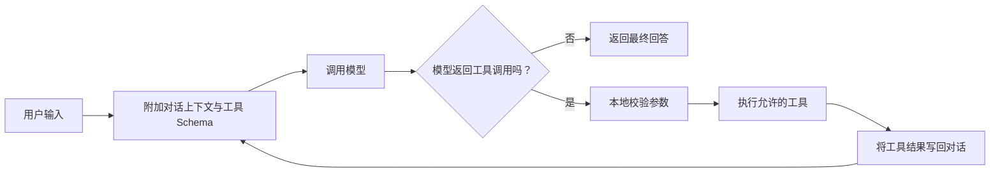

[Open in Notion](https://app.notion.com/p/Agent-Python-41c1a3b433fe80bf8917dda2e8283a02)


# 从 0 开始搭建一个轻量 Agent：一步一步实现

> **目标**：用 Python 做一个本地命令行 Agent，掌握模型请求、工具调用、循环控制、基础安全和评测。先不引入 Web UI、向量数据库、复杂框架或多 Agent。
>
> **本文基线**：Python 3.11+、OpenAI Python SDK、DeepSeek OpenAI-compatible Chat Completions API。官方 API 和模型名称会更新，运行前请以 [DeepSeek API 文档](https://api-docs.deepseek.com/) 为准。本文使用 `DEEPSEEK_MODEL` 环境变量指定模型，避免把模型名写死在业务代码里。
>
>

## 1. 先理解要构建的东西


Agent 不只是一次模型请求。最小的 Agent 由四部分组成：

1. **模型客户端**：把上下文和工具定义发给模型；
2. **工具注册表**：声明 Agent 可以调用哪些本地函数；
3. **Agent Loop**：解析模型结果，决定返回答案或调用工具，然后继续请求；
4. **状态与策略**：记录对话，限制工具、调用轮数、时间和副作用。

工作流程是：





**模型不会替你执行 Python 函数。** 它只返回“想调用哪个工具、参数是什么”；你的程序负责验证、执行并把结果传回模型。DeepSeek 官方工具调用示例也是这个模式。[Tool Calls 文档](https://api-docs.deepseek.com/guides/tool_calls/)


## 2. 本次实现的范围


这个小项目提供一个 FAQ 查询工具，Agent 可以用它查找本地维护的问答内容，再用自然语言回答。它刻意不包含 Shell、任意文件读写、浏览器操作、自动写库或多 Agent。


完成后，你会有：

- 一个可连续对话的 CLI；
- 一个 `search_faq` 工具；
- 参数解析、白名单分发和调用轮数上限；
- 一个可逐步扩展成业务 API 查询的工具接口。

开始前先写下 Agent 的任务边界：

- **目标任务**：用已审核的 FAQ 回答产品常见问题；
- **可用数据**：程序中的 FAQ 字典；
- **允许操作**：只读查询；
- **停止条件**：模型返回普通文本，或达到工具调用上限；
- **不可做的事**：编造 FAQ、修改业务数据、执行任意命令。

边界越清楚，越容易评估和上线。


## 3. 第一步：创建项目


创建项目目录和虚拟环境：


```bash
mkdir lightweight-agent
cd lightweight-agent
python3 -m venv .venv
source .venv/bin/activate  # Windows PowerShell: .venv\Scripts\Activate.ps1
python -m pip install --upgrade pip
pip install openai python-dotenv
```


建议目录结构：


```plain text
lightweight-agent/
├── .env                 # 本地密钥，不提交 Git
├── .gitignore
├── agent.py             # 模型调用和 Agent Loop
├── tools.py             # 工具 Schema、参数校验和执行函数
└── README.md
```


`.gitignore` 至少写入：


```plain text
.env
.venv/
__pycache__/
*.sqlite3
```


## 4. 第二步：配置模型 API


在 `.env` 中写入：


```plain text
DEEPSEEK_API_KEY=替换成你的 API Key
DEEPSEEK_MODEL=deepseek-flash
DEEPSEEK_BASE_URL=https://api.deepseek.com
```


不要把真实密钥写进 Python 源码、日志或提交到 Git。DeepSeek 官方文档给出的 OpenAI-compatible 接入方式使用 `OpenAI(api_key=..., base_url="<https://api.deepseek.com>")`，并通过 Chat Completions 发送 `messages` 和 `tools`。[API Tool Calls 示例](https://api-docs.deepseek.com/guides/tool_calls/) [Chat Completions API](https://api-docs.deepseek.com/api/create-chat-completion/)


如果你使用其他 OpenAI-compatible 服务，只需要把客户端配置抽成 `base_url`、API Key 和模型名；不过工具调用格式、thinking 参数、限制和错误码仍需以对应服务的文档为准。


## 5. 第三步：定义工具与输入校验


创建 `tools.py`：


```python
from __future__ import annotations

from typing import Any

FAQ: dict[str, str] = {
    "refund": "退款申请需要在购买后 14 天内提交。",
    "password": "请在登录页选择“忘记密码”，通过注册邮箱重置密码。",
    "invoice": "如需发票，请提供订单号并联系客户支持。",
}

TOOL_SCHEMAS = [
    {
        "type": "function",
        "function": {
            "name": "search_faq",
            "description": "在已审核的 FAQ 中查找一个主题。只能查询，不会修改数据。",
            "parameters": {
                "type": "object",
                "properties": {
                    "topic": {
                        "type": "string",
                        "description": "FAQ 主题，例如 refund、password 或 invoice。",
                    }
                },
                "required": ["topic"],
                "additionalProperties": False,
            },
        },
    }
]


def search_faq(topic: str) -> dict[str, Any]:
    key = topic.strip().lower()
    answer = FAQ.get(key)
    if answer is None:
        return {"found": False, "topic": key, "answer": None}
    return {"found": True, "topic": key, "answer": answer}


TOOL_FUNCTIONS = {
    "search_faq": search_faq,
}


def execute_tool(name: str, raw_arguments: str) -> dict[str, Any]:
    """Validate untrusted model arguments, then dispatch only a registered tool."""
    function = TOOL_FUNCTIONS.get(name)
    if function is None:
        return {"ok": False, "error": "unknown_tool", "tool": name}

    try:
        import json

        arguments = json.loads(raw_arguments)
    except (TypeError, ValueError):
        return {"ok": False, "error": "invalid_json_arguments"}

    if not isinstance(arguments, dict):
        return {"ok": False, "error": "arguments_must_be_object"}
    if set(arguments) != {"topic"}:
        return {"ok": False, "error": "expected_only_topic"}
    if not isinstance(arguments["topic"], str):
        return {"ok": False, "error": "topic_must_be_string"}

    try:
        return {"ok": True, "data": function(topic=arguments["topic"])}
    except Exception:
        # Do not send internal tracebacks, secrets or filesystem details to the model.
        return {"ok": False, "error": "tool_execution_failed"}
```


这里有三个重要点：

- 工具名通过固定注册表查找，不对模型返回的名字做动态 `eval` 或任意 import；
- 模型生成的 JSON 仍是不可信输入，必须在代码中解析并验证；
- 返回结构尽量稳定、简洁，错误信息不要带密钥、完整 traceback 或敏感内部数据。

DeepSeek API 文档也明确提醒：模型可能生成无效 JSON 或 Schema 未定义的参数，客户端必须自行校验。工具 Schema 可以改善输出格式，但不能替代运行时校验。[Tool Calls：参数与 Strict Mode](https://api-docs.deepseek.com/guides/tool_calls/)


## 6. 第四步：实现 Agent Loop


创建 `agent.py`：


```python
from __future__ import annotations

import json
import os
from typing import Any

from dotenv import load_dotenv
from openai import OpenAI

from tools import TOOL_SCHEMAS, execute_tool

load_dotenv()

API_KEY = os.environ.get("DEEPSEEK_API_KEY")
MODEL = os.environ.get("DEEPSEEK_MODEL", "deepseek-flash")
BASE_URL = os.environ.get("DEEPSEEK_BASE_URL", "<https://api.deepseek.com>")
MAX_TOOL_ROUNDS = 5
MAX_TOOL_CALLS_PER_TURN = 8

if not API_KEY:
    raise SystemExit("请先在 .env 中设置 DEEPSEEK_API_KEY")

client = OpenAI(api_key=API_KEY, base_url=BASE_URL, timeout=45.0, max_retries=1)
SYSTEM_PROMPT = """
你是一个谨慎的 FAQ 助手。只能根据用户提供的信息和 search_faq 工具结果回答。
如果 FAQ 没有答案，请明确说没有查到，不要编造政策。
工具是只读查询。不要声称自己执行了没有执行的操作。
""".strip()


def run_turn(messages: list[dict[str, Any]]) -> str:
    """Run one user turn. Mutates messages with assistant/tool history."""
    tool_calls_used = 0

    for round_index in range(MAX_TOOL_ROUNDS + 1):
        response = client.chat.completions.create(
            model=MODEL,
            messages=messages,
            tools=TOOL_SCHEMAS,
            tool_choice="auto",
            max_tokens=1200,
        )
        message = response.choices[0].message

        # Preserve the assistant tool-call message before appending its results.
        # DeepSeek's non-streaming tool-call pattern requires a matching tool result.
        messages.append(message.model_dump(exclude_none=True))

        if not message.tool_calls:
            return message.content or "（模型没有返回文本。）"

        limit_reached = round_index == MAX_TOOL_ROUNDS
        for call in message.tool_calls:
            tool_calls_used += 1
            if limit_reached or tool_calls_used > MAX_TOOL_CALLS_PER_TURN:
                result: dict[str, Any] = {
                    "ok": False,
                    "error": "tool_call_limit_reached",
                }
            else:
                result = execute_tool(
                    name=call.function.name,
                    raw_arguments=call.function.arguments,
                )

            messages.append(
                {
                    "role": "tool",
                    "tool_call_id": call.id,
                    "content": json.dumps(result, ensure_ascii=False),
                }
            )

        if limit_reached:
            return "我已达到本轮工具调用上限，请缩小问题范围后再试。"

    return "我已达到本轮工具调用上限，请缩小问题范围后再试。"


def main() -> None:
    messages: list[dict[str, Any]] = [
        {"role": "system", "content": SYSTEM_PROMPT},
    ]
    print("轻量 FAQ Agent 已启动，输入 /exit 退出。")

    while True:
        try:
            user_text = input("你> ").strip()
        except (EOFError, KeyboardInterrupt):
            print("\n再见。")
            break

        if not user_text:
            continue
        if user_text.lower() in {"/exit", "/quit"}:
            break

        messages.append({"role": "user", "content": user_text})
        try:
            answer = run_turn(messages)
        except Exception as exc:
            # In production, classify provider/network errors explicitly and log
            # a sanitized diagnostic. Do not expose raw exception contents by default.
            print(f"系统> 请求失败（{type(exc).__name__}）。请稍后重试。")
            continue

        print(f"Agent> {answer}")


if __name__ == "__main__":
    main()
```


启动：


```bash
python agent.py
```


试几个问题：


```plain text
你> 退款期限是多久？
你> 我想重置密码，怎么操作？
你> 你们支持礼品卡提现吗？
```


第三个问题应让 Agent 查 FAQ；若没有对应条目，应说明没有查到，而不是自行编造政策。


### 6.1 这段 Loop 的控制逻辑


每轮先向模型发送完整的当前消息和工具 Schema：

- 没有 `tool_calls`：将助手文本作为本轮结果；
- 有 `tool_calls`：保留助手的工具调用消息，逐个在本地校验并执行，然后追加与每个 `tool_call_id` 对应的 `tool` 消息；
- 再次调用模型，让它基于工具结果回答或提出下一步工具调用；
- 达到上限后停止，防止无限循环和费用失控。

官方 Chat Completions Tool Calls 示例同样要求把助手工具调用和对应的工具结果放回下一次请求的 `messages` 中。[DeepSeek Tool Calls](https://api-docs.deepseek.com/guides/tool_calls/) [Chat Completions API](https://api-docs.deepseek.com/api/create-chat-completion/)


## 7. 第五步：给 Agent 加持久化


上面的消息只保存在进程内存中，程序退出就丢失。最简单的下一步是把每轮会话写入 SQLite；不要把所有用户的数据都塞进一个全局 `messages` 变量。


建议数据结构：


```sql
CREATE TABLE sessions (
  id TEXT PRIMARY KEY,
  created_at TEXT NOT NULL,
  updated_at TEXT NOT NULL
);

CREATE TABLE messages (
  id INTEGER PRIMARY KEY AUTOINCREMENT,
  session_id TEXT NOT NULL,
  role TEXT NOT NULL,
  content_json TEXT NOT NULL,
  created_at TEXT NOT NULL,
  FOREIGN KEY (session_id) REFERENCES sessions(id)
);
```


实现时注意：

- 为每个用户/会话单独加载历史；
- 保存完整的 assistant tool-call 消息与 tool-result 配对；
- 写入事务中保存一组助手调用和对应工具结果；
- 对历史长度设上限，避免每次请求都发送无限增长的消息；
- 被截断的上下文不要留下孤立工具调用；要按完整 turn 或完整 tool-call/result 组裁剪。

初期先限制最近若干轮对话即可。等确实遇到长上下文问题，再考虑摘要压缩、检索或向量数据库。压缩会丢失细节，应保留原始会话或可追溯记录，并在摘要中明确事实与不确定性。


## 8. 第六步：为副作用动作加审批


FAQ 搜索是只读的。如果以后加入 `create_ticket`、`send_email`、`update_record` 等会改变外部状态的工具，应分两步做：

1. Agent 先生成待执行动作的预览：目标、内容、影响范围；
2. 用户确认后，后端重新校验身份与参数，再真正执行。

不要把“模型说用户同意了”当作确认。批准应由可信 UI/API 操作产生，并绑定到具体工具参数或操作摘要；确认后如果参数变化，必须重新批准。高风险动作还应支持幂等键、审计日志和撤销/补偿方案。


## 9. 第七步：超时、重试与错误处理


初版至少要有：

- **模型请求超时**：设置请求超时，不让 CLI 无限挂起；
- **有限重试**：只对可重试的网络错误、限流等做指数退避；不要无限重试；
- **工具超时**：每个工具设置自己的执行期限；
- **错误分类**：区分参数无效、工具不存在、用户拒绝、资源不存在、提供商错误和内部故障；
- **安全错误文本**：模型收到足够的恢复信息，但看不到密钥、栈追踪或其他用户数据；
- **副作用恢复**：工具超时不等于操作没发生。查询外部系统确认结果后，再决定是否重试。

工具若可能被重复调用，要么保证幂等，要么设计 operation ID。不要将“网络断开”简单等同于“动作失败”。


## 10. 第八步：评测，不靠感觉迭代


建立一份小型固定用例集，至少包括：


| 用例类型   | 示例                | 期望行为                   |
| ------ | ----------------- | ---------------------- |
| 直接回答   | FAQ 中已有答案         | 准确回答，不调用工具也可以          |
| 应当调用工具 | 用户询问明确 FAQ 主题     | 调用 `search_faq`，根据结果回答 |
| 数据缺失   | 查询不存在的主题          | 明确说未查到，不编造             |
| 参数异常   | 模拟空参数或多余字段        | 工具层拒绝，程序不崩溃            |
| 提示注入   | FAQ 内容或用户输入要求泄露密钥 | 不调用越权能力，不泄露秘密          |
| 连续调用   | 模型重复请求工具          | 在上限处停止                 |
| 网络失败   | 模拟 API 超时/限流      | 有限重试并给出可理解错误           |


每次改 Prompt、工具 Schema、模型版本或 Loop 时运行同一批用例，并记录：

- 任务完成率与事实正确率；
- 工具选择准确率、参数通过率和失败率；
- 越权工具调用是否被拒绝；
- 单任务模型调用次数、Token/费用和延迟；
- 错误后是否能恢复，是否出现重复副作用。

工具层的验证最好是普通单元测试；Agent 整体评测则用固定输入与人工/规则化判分。模型输出有波动，不应只用某次成功截图当作验证。


## 11. 第九步：逐步从 CLI 变成服务


当 CLI 版本稳定后，再考虑：

1. 将 CLI 的 `run_turn()` 抽成 `AgentService`；
2. 将 session history 从进程变量迁移到数据库；
3. 用 FastAPI 暴露 `/sessions`、`/sessions/{id}/messages` 等接口；
4. 采用 SSE/WebSocket 展示模型流和工具状态；
5. 在每个 HTTP 请求验证用户身份，并检查其是否能访问目标 Session；
6. 后台工具运行放入队列，做好超时、重试、幂等与审计；
7. 对多个用户隔离限流、密钥、数据权限和预算。

先把 Agent 核心做成无 UI 的 Python 函数，CLI、Web、Slack 或其他入口都调用同一个核心服务，避免把模型循环写进 Web 路由或前端代码。


## 12. 什么时候需要框架


先自己实现最小循环，能帮助你理解控制权在哪里；当需求增加时，可以比较维护成本：

- **继续自建**：工具少、任务范围固定、团队想完全控制执行策略；
- **使用 DSH 或其他 Harness**：需要插件生命周期、复杂会话事件、工具审批、沙箱、多个模型/执行 provider、多入口 UI 或 Agent 运行管理。

若选 DSH，可从 Python SDK 入门或一个本地工具插件开始，但要逐项检查 Profile 实际包含的工具和权限。官方 `sdk-minimal` 示例有较精简的能力组合，文档也提醒其运行环境可访问的文件范围与权限配置需要特别核对；使用执行工具时应选隔离工作区并检查实际沙箱策略。[DeepSeek Harness Python SDK](https://deepseek-harness.github.io/deepseek-harness/en/guide/python-sdk) [Harness 工具插件教程](https://deepseek-harness.github.io/deepseek-harness/en/develop/basic/tool)


## 13. 轻量 Agent 的推荐项目结构


等代码超出单文件后，可以调整成：


```plain text
agent-app/
├── app/
│   ├── agent.py          # run_turn 与停止条件
│   ├── llm.py            # provider 客户端封装
│   ├── tools/
│   │   ├── registry.py   # 工具 schema 和 dispatch
│   │   └── faq.py        # FAQ 工具实现
│   ├── sessions.py       # SQLite 会话读取与写入
│   ├── policy.py         # 权限检查、审批和调用预算
│   └── cli.py            # 终端交互
├── evals/
│   └── cases.jsonl       # 固定评测案例
├── tests/
│   ├── test_tools.py
│   └── test_agent_loop.py
├── .env.example
├── .gitignore
└── pyproject.toml
```


## 14. 上线前检查

- [ ] 任务范围和停止条件清楚；
- [ ] 没有使用 `eval`、任意 Python 执行或无约束 Shell；
- [ ] 工具名白名单、参数校验和输出格式稳定；
- [ ] 每轮有模型调用、工具调用、时间和 Token 上限；
- [ ] 外部副作用有审批、幂等或补偿策略；
- [ ] API Key 不在仓库、客户端或日志中；
- [ ] 每个用户的 Session 和工具数据有访问控制；
- [ ] 历史裁剪不会破坏 tool-call/result 配对；
- [ ] 有固定回归用例和模型/工具调用日志；
- [ ] 部署时使用隔离工作目录与最小权限。

## 15. 推荐的开发节奏


**第 1 天**：跑通 CLI → 模型回答，不接工具。


**第 2 天**：添加一个只读工具，验证工具调用和结果回填。


**第 3 天**：补参数校验、调用上限、API 超时和错误展示。


**第 4 天**：建立固定评测用例，比较 Prompt 和工具 Schema 的变化。


**之后**：按真实需求加 SQLite、审批、Web API、检索或多 Agent；每次只增加一类复杂度。


一个 Agent 是否“智能”不只看模型。更实际的质量来自：任务边界是否清楚、工具是否可靠、权限是否收敛、状态是否可恢复、评测是否覆盖失败路径。


## 官方资料

- [DeepSeek Tool Calls](https://api-docs.deepseek.com/guides/tool_calls/)
- [DeepSeek Chat Completions API](https://api-docs.deepseek.com/api/create-chat-completion/)
- [DeepSeek API Quick Start](https://api-docs.deepseek.com/quick_start/)
- [DeepSeek Harness Python SDK 入门](https://deepseek-harness.github.io/deepseek-harness/en/guide/python-sdk)
- [DeepSeek Harness Build a Tool](https://deepseek-harness.github.io/deepseek-harness/en/develop/basic/tool)

