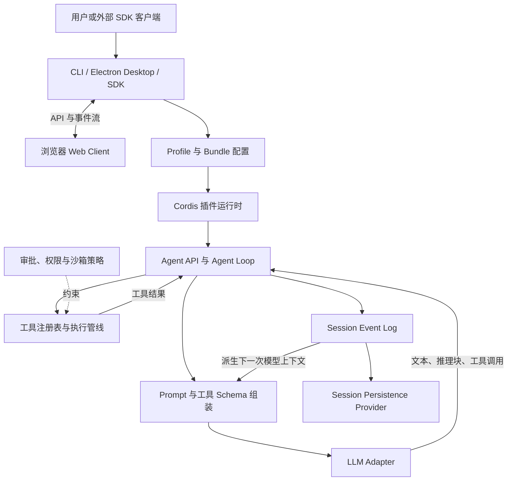

[Open in Notion](https://app.notion.com/p/DeepSeek-Harness-DSH-41c1a3b433fe80e6b07cf689fabc9fc8)


# DeepSeek Harness（DSH）技术架构与工作原理

> **分析范围**：DeepSeek AI 官方开源仓库 [`deepseek-ai/deepseek-harness`](https://github.com/deepseek-ai/deepseek-harness) 及其官方文档。本文描述的是 Harness（Agent 运行时与应用框架），不是 DeepSeek 模型权重或模型训练架构。
>
> **时效说明**：本文于 2026-11-18 按官方 README、架构文档和子系统文档整理。仓库 README 当前将项目标为 developer preview，并提示可能有兼容性破坏。项目更新较快；链接多数指向滚动更新的 `master` 文档，源码路径和接口可能随版本变化。
>
>

## 1. 概要：它解决什么问题


DeepSeek Harness（简称 DSH，命令名 `dsh`）把大语言模型接入一个可执行任务的 Agent 应用。它负责的事情包括：

- 接收用户输入，维护 Agent 与会话生命周期；
- 组装模型请求所需的对话历史、系统提示和工具定义；
- 调用模型适配器并处理流式响应；
- 调度工具调用，把工具结果送回模型；
- 记录会话事件并提供持久化、恢复能力；
- 通过插件、配置和不同应用 profile，组合 Web、SDK、无界面等形态。

因此，DSH 不等同于某个模型。模型负责生成文本或提出工具调用；Harness 决定模型能看到哪些工具、工具如何在宿主环境执行、执行结果如何进入对话，以及一次任务何时结束。


一句话概括其核心设计：

> **Cordis 装配插件和服务，Agent Loop 驱动模型—工具循环，Session 事件日志保存交互事实，Profile 决定启动哪种产品组合。**

## 2. 架构全景





这是逻辑结构，不代表每个部署都以完全相同的进程或服务边界运行。官方 profile 会复用一组基础能力，再添加 Web、Headless、SDK 或 ACP 等应用入口。桌面应用采用 Electron 承载本地 Host 与 Web 应用；Web 前端通过 API Gateway 与 Host 通信。[架构文档](https://github.com/deepseek-ai/deepseek-harness/blob/master/docs/architecture.md) [Web Client 架构](https://deepseek-harness.github.io/deepseek-harness/en/reference/subsystems/web-client)


## 3. 第一层：启动、Profile 与插件装配


### 3.1 Profile 和 Bundle


`dsh` 通过命名 profile 启动应用。官方文档列出 `web`、`headless`、`sdk`、`sdk-minimal` 和 `acp` 等 profile。Profile 将多个 Bundle 按顺序叠加；Bundle 则是一组 Cordis 配置行及其加载的代码。


概念上可以理解为：


```plain text
应用入口
  └─ Profile
      ├─ 通用能力 Bundle（模型、工具、持久化、策略等）
      ├─ 应用 Bundle（Web、SDK、ACP 等）
      ├─ Profile 级 patch
      ├─ 用户 Harness home 中的 patch
      └─ 命令行 --patch 覆盖
```


后加载的层可以替换或补充插件配置。这样，用户能调整运行时组合，而无需为每个变体维护一份独立的应用实现。`dsh --profile web --dump-config` 可查看当前展开后的配置树。[官方架构文档：Profiles 与 Bundles](https://github.com/deepseek-ai/deepseek-harness/blob/master/docs/architecture.md)


### 3.2 Cordis：共享 Context、服务依赖和可撤销副作用


Cordis 是 DSH 使用的插件框架。插件通常声明依赖的服务，并在服务可用后加载。例如，工具插件依赖工具注册服务，模型适配器插件向 LLM 服务注册适配器。插件通过共享 Context 访问稳定的服务接口，如 `ctx.llm`、`ctx.tools`、`ctx.sessions` 和 `ctx.agents`。


插件注册工具、事件监听器或资源时，这些注册属于插件的生命周期；卸载时对应清理逻辑会执行。插件状态大致经历：


```plain text
PENDING → LOADING → ACTIVE → UNLOADING → DISPOSED
                         ↘ FAILED
```


依赖关系由服务注入表达。依赖服务消失时，依赖它的插件可以卸载；服务恢复时再重新加载。Cordis 事件有不同派发语义：有的只广播事实，有的让多个处理器按 waterfall 方式包裹和改写结果，有的串行执行并等待完成。


这种设计的关键并不是“所有东西都可以任意改”，而是：能力有明确注册点，插件通过服务或事件与其他模块交互，生命周期内的注册可以回收。这降低了扩展时对具体实现的耦合，也意味着调试问题时需要看清楚哪些插件被加载、事件经过哪些监听器。[Cordis Primer](https://deepseek-harness.github.io/deepseek-harness/en/reference/cordis-primer) [插件生命周期](https://deepseek-harness.github.io/deepseek-harness/en/develop/framework/)


## 4. 第二层：核心服务与职责边界


官方架构把 Agent 执行主干分到若干包中：


| 子系统                  | 主要职责                           |
| -------------------- | ------------------------------ |
| `core/session`       | Session 事件日志和内存态会话存储，提供交互状态来源  |
| `core/system-prompt` | 汇总系统提示片段与模型可见的工具 Schema        |
| `core/tools`         | 工具注册、Schema 投影和受控执行管线          |
| `core/agent`         | 对外的 Agent 接口、注册表及 `agent/*` 事件 |
| `core/agent-loop`    | 默认 Agent 驱动器，执行 turn/step 生命周期 |
| `llm/llm`            | 消息、内容块、流式响应类型和模型适配器接口          |
| `core/scope`         | 为 Agent 范围内的注册和事件提供隔离原语        |


一个重要的依赖方向是：扩展通常面向 Agent 的公共接口和能力服务，而不是直接依赖默认 Loop 的内部实现。这样默认循环可以被替换，插件仍能围绕稳定服务和事件工作。[Architecture：Core packages](https://github.com/deepseek-ai/deepseek-harness/blob/master/docs/architecture.md) [Core 子系统](https://deepseek-harness.github.io/deepseek-harness/en/reference/subsystems/core)


## 5. 第三层：一次用户请求如何变成 Agent 工作


### 5.1 Agent、Turn 与 Step


DSH 用三个层次组织工作：

- **Agent**：一个持续存在的执行主体，绑定一个 Session 和运行期能力；
- **Turn**：一次用户输入触发的处理周期；
- **Step**：一次模型请求，以及该请求引发的工具调用处理。

一个 Turn 可能只有一个 Step（模型直接回答），也可能连续经历多个 Step（模型调用工具，工具结果返回后再次请求模型）。[Agent Loop 参考](https://github.com/deepseek-ai/deepseek-harness/blob/master/packages/core/agent-loop/README.md)


### 5.2 输入领取与前置决策


Agent Loop 从 Inbox 领取排队输入。进入模型请求前，系统会确定当前 Session 的模型选择，准备 prompt 和该 Step 可用的工具 Schema，并触发 `agent/pre-step` 扩展点。监听器可接受、改写或拒绝本次输入。某些运行时上下文也会在此阶段投影到请求所需内容。


这样做使“接受什么输入进入模型历史”成为可插拔的生命周期环节，而不是散落在 UI 或模型调用代码中的隐式逻辑。


### 5.3 Prompt 与工具 Schema 组装


Prompt 由系统提示片段、会话历史及运行时上下文共同形成。工具注册表根据当前可用能力生成模型侧可见的 Schema。模型得到的是工具名称、描述和参数定义；执行函数、超时设置、并发控制和界面展示回调等宿主内部信息不会作为模型工具 Schema 泄露给模型。


系统提示和会话消息会进入 Session 事件流；Loop 从日志投影模型需要的消息序列，而不是把 UI 当前显示的聊天文本直接当作唯一状态。


### 5.4 模型适配器与流式输出


LLM 层定义统一的消息和流式数据协议。模型适配器负责把统一请求转换成某个 provider 的协议，再把返回内容映射回 Harness 的通用流格式。这样 Agent Loop 不必为每个模型提供商分别实现整套会话循环。


一次请求大致包含：

1. 依据当前 provider/model 选择适配器；
2. 准备并校验该适配器支持的请求字段；
3. 发送上下文和工具 Schema；
4. 接收文本、推理内容块或工具调用块；
5. 将结果流交给 Loop 处理。

流式文本可实时交给界面展示，但官方架构区分了“进程内的实时流帧”和“已经持久化的会话事实”：完整的助手消息或失败尝试在结算后成为日志事件。这样能让 UI 有增量体验，同时让会话重放依赖明确的结算记录。[LLM Streaming 子系统](https://deepseek-harness.github.io/deepseek-harness/en/reference/subsystems/llm-streaming) [Turn flow](https://github.com/deepseek-ai/deepseek-harness/blob/master/docs/architecture.md)


## 6. 第四层：工具调用如何执行


### 6.1 从模型意图到宿主执行


模型产生工具调用时，返回的是调用名称、参数和调用 ID。Harness 将它与已注册的工具定义匹配，校验参数，然后通过工具执行管线调度实际函数。执行完成后，结果被规范化并记录为工具结果，再进入下一次模型请求上下文。


典型链路：


```plain text
模型工具调用
  → 工具注册表匹配
  → 参数校验
  → 前置策略 / 审批 / 调度
  → 工具执行
  → 结果校验与规范化
  → 后置策略
  → 写入 tool/result
  → 下一次模型请求
```


### 6.2 工具 Schema 与工具实现分离


模型需要知道“能调用什么、参数是什么”；宿主需要知道“调用时执行什么、输出如何处理”。DSH 把这两种职责放在 `ToolDefinition` 中，但构造模型请求时通过 allowlist 仅投影模型可见的 Schema 字段。参数与输出可由 Schema 描述并在运行时校验，工具执行返回规范化值，之后再投影成模型内容或界面展示内容。[Tools 子系统](https://deepseek-harness.github.io/deepseek-harness/en/reference/subsystems/tools)


### 6.3 并发、取消和安全策略


工具执行器管理调度、并发、取消和工具调用日志。某些工具可以并发运行；需要相互排斥的执行可通过执行元数据和管线策略处理。取消是协作式的：Loop 会发出取消信号，工具应观察这个信号并在其拥有的工作真正结束后完成。对同一进程内任意代码，Harness 无法凭一个信号强制杀死它。


审批策略和沙箱策略属于可组合的能力层。默认 profile 会组合模型、工具、持久化以及相应策略；具体安全行为取决于实际加载的策略插件、工具后端和配置，不能仅凭“使用了 Harness”推断任意执行环境都已隔离。[Profile 组成](https://github.com/deepseek-ai/deepseek-harness/blob/master/docs/architecture.md) [Permission Presets](https://deepseek-harness.github.io/deepseek-harness/en/reference/subsystems/permission-presets)


## 7. 第五层：Session 事件溯源与上下文派生


### 7.1 Session 是事实日志


Session 是追加式、带类型的事件序列。常见事件包括 turn/step 的开始与结束、系统提示、用户消息、助手消息、助手失败尝试、工具调用和工具结果。事件序号连续，历史事实不通过“原地改写”来更新。


模型看到的消息历史由 `deriveMessages()` 从 Session 事件派生。这种做法称为事件溯源：系统保存发生过的事实，再从这些事实构建供模型、UI、查询或恢复使用的投影。[Sessions 子系统](https://deepseek-harness.github.io/deepseek-harness/en/reference/subsystems/session)


### 7.2 为什么区分已提交消息与临时流


模型逐块返回内容时，UI 可以先显示流式片段；但会话日志应记录一个可解释的完成状态。DSH 的架构将流式增量帧用于进程内实时通知，将完整助手消息或尝试结果作为持久事件结算。这样，UI 的流式呈现不等于日志中已经提交了完整消息。


### 7.3 持久化与恢复


持久化通过 `SessionPersistence` 服务抽象出来。存储后端通过每个 Session 的 Handle 读写日志，并管理写入归属和 flush 屏障；官方提供 JSONL 持久化 provider。`append` 表示事件批次已被后端接受，但真正承诺可从崩溃中保留的是成功的 `flush`。写入句柄关闭时也会处理待写入数据。


如果进程在一个 Turn 中途退出，恢复逻辑会读取仍然有效的日志，并补上中断 Turn 所需的闭合事件和缺失工具结果，再恢复 Agent。存储层负责保存物理日志；Loop/Session 语义层负责判断怎样修复一个未正常结束的任务。这种职责分离减少了存储后端对 Agent 业务语义的了解。[Session Persistence 子系统](https://deepseek-harness.github.io/deepseek-harness/en/reference/subsystems/persistence)


## 8. 第六层：Web、Desktop、SDK 与 Host/Client 边界


### 8.1 Web Client


Web 前端本身也由插件组成。文档描述的主要层次包括 Host 业务服务、API Gateway 与传输、客户端状态模型、UI 适配层、会话呈现与 React 组件。依赖方向总体为：


```plain text
Host 状态 → Remote/API 传输 → Client Model → UI Adapter → Conversation/UI → React
```


Host 拥有权威业务状态、持久化和变更顺序；客户端维护对应的只读/交互模型并呈现 UI。UI 组件不直接持有 Cordis Context 或底层传输对象，而通过明确的服务接口与模型交互。[Web Client 架构](https://deepseek-harness.github.io/deepseek-harness/en/reference/subsystems/web-client)


### 8.2 Desktop


官方桌面应用使用 Electron。Electron Host 启动共享 CLI profile runner 和完整 Web 应用；窗口加载打包的 Web 资源，再通过本地连接与 Host 通信。这样桌面 UI 可以复用 Web 应用和 API 模型，而本地进程能力仍由 Host 所有。[官方架构文档：Desktop application](https://github.com/deepseek-ai/deepseek-harness/blob/master/docs/architecture.md)


### 8.3 SDK 与 Headless


SDK profile 让其他程序以服务/API 形式连接 Harness；Headless profile 则面向无 Web Server 的一次性运行。二者复用 Agent 主干，但启动插件树不同。集成方因此应把 profile、配置 patch 与 SDK 版本作为运行时契约的一部分，而不是假定所有入口都具有相同的工具和服务集合。


## 9. 一次完整任务的时序复盘


```plain text
1. 启动 dsh，选定 profile，按 Bundle 与 patch 组合插件树
2. Cordis 根据服务依赖加载插件并建立服务注册
3. 用户消息进入 Agent Inbox
4. Agent Loop 开始 Turn，领取输入
5. 读取模型选择，组装系统提示、上下文和工具 Schema
6. pre-step 扩展点接受/改写/拒绝输入
7. 准备模型适配器调用，并把已接受消息提交到 Session
8. 从 Session 派生不可变模型请求并开始流式调用
9. 接收助手文本或工具调用
10. 对工具调用做匹配、校验、策略检查、执行和结果规范化
11. 将助手消息、工具调用和结果等事实追加到 Session
12. 若工具结果要求模型继续，回到第 5 步开启下一个 Step
13. 没有待办时结束 Turn；持久化策略在相应检查点 flush
14. UI/SDK 通过 Host 服务和事件流观察状态或提交下一条输入
```


## 10. 架构上的优点与工程代价


### 优点

- **可替换性**：模型适配器、工具、Loop、存储和 UI 能力有相对清楚的扩展接缝。
- **组合复用**：Web、Desktop、SDK、Headless 可复用基础 Agent 能力，通过 Profile 选择不同运行形态。
- **状态可追溯**：Session 日志为重放、恢复和审计提供共同来源。
- **生命周期明确**：插件注册的监听器和资源绑定生命周期，支持卸载、重载和测试隔离。
- **模型与宿主职责分离**：模型发出调用意图，Harness 决定工具注册、执行和策略边界。

### 工程代价

- **理解成本较高**：一个行为可能由多个插件通过事件共同组成，需要追踪插件树和事件链。
- **配置决定运行时**：Profile 与 patch 会改变实际加载能力；仅看某个包的代码不一定能推导部署行为。
- **事件模型需要治理**：事件格式演进、历史兼容、迁移、崩溃恢复和幂等处理都很关键。
- **取消和安全有边界**：协作式取消不能强行终止任意同进程代码；安全性还依赖 sandbox、approval 与实际工具实现。
- **接口仍在演进**：developer preview 阶段需要锁定版本，并谨慎依赖尚未稳定的扩展契约。

## 11. 阅读源码的建议顺序


如果要进一步做代码级分析，建议按以下顺序阅读：

1. [README](https://github.com/deepseek-ai/deepseek-harness/blob/master/README.md)：项目定位、启动方式和开发状态；
2. [docs/architecture.md](https://github.com/deepseek-ai/deepseek-harness/blob/master/docs/architecture.md)：profile、核心包、事件和完整 turn 流程；
3. [Cordis Primer](https://deepseek-harness.github.io/deepseek-harness/en/reference/cordis-primer)：插件、服务、事件语义；
4. [Agent Loop README](https://github.com/deepseek-ai/deepseek-harness/blob/master/packages/core/agent-loop/README.md)：Agent 创建、恢复、turn/step 和错误处理；
5. [Core 子系统](https://deepseek-harness.github.io/deepseek-harness/en/reference/subsystems/core) 与 [Session 子系统](https://deepseek-harness.github.io/deepseek-harness/en/reference/subsystems/session)：核心接口与事件语义；
6. [Tools 子系统](https://deepseek-harness.github.io/deepseek-harness/en/reference/subsystems/tools) 与 [LLM Streaming](https://deepseek-harness.github.io/deepseek-harness/en/reference/subsystems/llm-streaming)：模型调用边界和工具执行；
7. [Session Persistence](https://deepseek-harness.github.io/deepseek-harness/en/reference/subsystems/persistence)：存储句柄、flush 和中断恢复；
8. [Web Client 架构](https://deepseek-harness.github.io/deepseek-harness/en/reference/subsystems/web-client)：Host/Client/API/UI 分层。

## 12. 核心结论（概要）


DSH 的核心不是一个固定的“聊天机器人主循环”，而是一套**基于插件组合的 Agent 执行平台**。Cordis 提供模块装配与生命周期，Loop 提供逐步推理和工具调度，Session 事件流提供事实记录，持久化层负责可靠保存，Profile 则将这些能力组合成不同运行入口。


理解它时，建议始终区分三件事：

1. **模型生成了什么**：文本、推理内容或工具调用意图；
2. **Harness 决定并执行了什么**：输入接纳、工具授权、调用调度、错误/取消处理；
3. **Session 实际提交了什么**：可重建历史的持久事件。

这三个边界构成了 DSH 的工作原理，也决定了插件扩展、运行安全和故障恢复应从哪里分析。


## 13. 上下文长度、Token 测量与压缩


### 13.1 模型上下文不是简单的聊天文本


模型请求由一组规范化消息与内容块组成，内容可能包括文本、推理内容、图片、文件、工具调用和工具结果。Harness 从 Session 表面历史派生消息，再结合当前 provider/model 能力将附件序列化到请求。因此，“界面里显示了多少字”不等于“请求消耗了多少 Token”：工具 Schema、系统提示、图片视觉 Token、文件投影、历史消息都会影响请求大小。


### 13.2 Token Meter 的作用


`dsh-token-meter` 从已提交的 Session 日志计算一个可重放的测量快照，记录它消费到的日志 revision、当前消息表面各节点估算 Token、请求与响应压力，以及计数基线。若当前路由提供可信的 usage 信息，可使用与该请求包络相符的 usage 作为锚点；否则对当前请求表面采用路由价格或启发式估算。图片也按模型路由的视觉 Token 价格估算（若路由未声明价格则退回启发式）。


测量值是压缩与 UI 提示等消费者的依据，不是模型侧精确 Tokenizer 的普遍保证。更换模型、系统提示或工具集合会改变请求包络；任何预算判断都应对应当前路由和当前请求内容。[Token Meter 子系统](https://deepseek-harness.github.io/deepseek-harness/en/reference/subsystems/token-meter)


### 13.3 Compaction：压缩的是模型可见表面


Compaction 是独立可选能力，不是 Agent Loop 内置的必选步骤。它由服务定义、压缩后端和触发者组成；后端可使用模型总结或其他策略。典型压缩过程会：

1. 选择要压缩的历史表面范围并估算 Token；
2. 在 Session 中记录 `compaction/start`，表示压缩操作占用中；
3. 生成摘要并记录 `compaction/summary`，包括摘要、被遮蔽的事件范围、Token 测量和调用模型信息；
4. 追加一个 `user/message`，通过 `surfaceOp: replace` 替换模型可见历史中的旧范围；
5. 最后追加 `compaction/end` 释放锁。

底层 Session 仍然是追加式日志，旧事件没有被物理删除。压缩通过表面投影改变后续模型看到的内容；摘要和压缩审计事件与可见对话表面分离。若操作中断，缺少匹配 `compaction/end` 的开始事件能让恢复逻辑识别不完整操作。[Compaction 子系统](https://deepseek-harness.github.io/deepseek-harness/en/reference/subsystems/compaction)


### 13.4 压缩的取舍


压缩能降低后续请求的上下文成本，但会把详细原文替换成摘要投影，后续模型不一定还能取回被压缩内容的所有细节。是否自动触发、压缩窗口、摘要模型和失败处理由具体 profile 与压缩 provider 决定。不要把“事件日志仍保存旧消息”等同于“模型后续还能自动看到旧消息”。


## 14. 子 Agent、委派和工作流


### 14.1 子 Agent 是独立执行身份


DSH 的子 Agent 能力通过 `ctx.subagents` 和 provider 注册表抽象。每个子任务使用自己的 Session ID 作为执行身份；模型可见名称（如 `lead` 或路径名）只是寻址便利，不能代替 Session ID 进行授权或持久化。


Provider 可以启动本地可续作 Agent，也可以启动外部执行（例如通过 ACP 或其他 Agent 产品）。本地子 Agent 有独立 Session 和 Inbox；外部执行由 provider 返回的 run handle 管理。子 Agent 管理器负责启动、取消、结果收集、资源释放与父子关系发现。[Subagents 子系统](https://deepseek-harness.github.io/deepseek-harness/en/reference/subsystems/subagent)


### 14.2 上下文继承不是权限继承


本地创建方式可以选择把父 Session 已完成的历史前缀作为子 Session 的 seed，也可以创建较干净的子会话。该选择决定子 Agent 是否能从已有对话背景开始，但不等于自动继承父 Agent 的全部服务、工具、审批权或沙箱权限。Provider 的能力声明、Agent preset 和实际插件组合决定子 Agent 的运行环境。


因此应分别检查：

- 子 Agent 读到了什么历史；
- 子 Agent 加载了哪些工具和模型；
- 子 Agent 使用什么工作目录和策略；
- 哪个父级或用户主体有权发送消息、取消任务或读取结果。

### 14.3 通信、通知和结果


子 Agent 有独立生命周期。父 Agent 可以创建任务并选择结果交付方式；父级通知可携带任务结束摘要，Agent 之间的消息会记录发送者来源。可续作本地子 Agent 可被发送后续消息；运行中会在下一步接收，空闲时可开始新 Turn；冷会话在运行容量允许时可以恢复。外部一次性执行一般只提供单次执行结果，不具备相同的持续 Inbox 语义。


能力还包括列出子树、将消息发送到树内成员、取消特定活动以及等待仍在运行的树内工作。取消某个 activation、关闭整个子树和取消父 Agent 是不同生命周期操作。父级完成前是否等待子任务，取决于 Host / Loop 对树内工作的协调策略。


### 14.4 Subagent 与 Workflow / Agent Teams 的区别


Subagent 提供 Agent 身份、启动、通讯和运行管理；Workflow 提供模型编写或触发的编排脚本；Agent Teams（若配置启用）再加入共享任务板和任务策略。它们是可选能力，不属于最小 Agent Loop 必须依赖的部分。分析一次复杂协作时，需要确认使用的是哪一种编排能力，避免把“多个 Agent”误认为一个固定的内置并行算法。[Workflow 子系统](https://deepseek-harness.github.io/deepseek-harness/en/reference/subsystems/workflow) [官方架构参考](https://deepseek-harness.github.io/deepseek-harness/en/reference/)


## 15. 安全模型：策略、审批、沙箱和工具权限


### 15.1 安全不由 Prompt 承担


System Prompt 可以告诉模型有哪些规则，但它本身不是执行边界。真正约束动作的是模型可见工具集合、工具执行代码、Approval 服务、Sandbox provider、文件系统 provider、远程 API 鉴权和宿主运行权限。安全分析应追踪一次动作从模型工具调用到宿主副作用的完整链路。


### 15.2 Approval 与 Sandbox 是两个独立开关


Permission preset 将审批策略与沙箱模式作为一组 UI 选择呈现，但两者仍是独立执行机制：

- **Approval policy** 决定危险或需确认的操作是否需要人工应答；审批请求在所属 Session 的打开 Turn 中记录 ask/decision 审计事件。只有明确授权的结果才能放行；取消、应答器缺失或出错等情况按失败关闭语义处理。
- **Sandbox mode** 限制由受控执行器启动的进程对文件系统的影响。它不负责审批，也不能单独代表完整的网络、进程或身份隔离。

当前默认 preset 表在官方文档中列出 `workspace-write`（workspace-write + ask）和 `danger-full-access`（danger-full-access + never）。Preset 仅组合策略值；具体 enforcement 仍由对应 provider 实现。[User Approval](https://deepseek-harness.github.io/deepseek-harness/en/reference/subsystems/approval) [Permission Presets](https://deepseek-harness.github.io/deepseek-harness/en/reference/subsystems/permission-presets)


### 15.3 Sandbox 实际限制范围


官方 Sandbox 文档明确将 Sandbox Mode 定义为**文件系统副作用策略**：


| 模式                   | 设计意图               | 关键边界              |
| -------------------- | ------------------ | ----------------- |
| `read-only`          | 禁止受控进程写入文件         | 后端可能需要放行少量系统必需写入点 |
| `workspace-write`    | 允许写工作区及支持的额外目录和临时区 | 具体目录能力依平台后端而异     |
| `danger-full-access` | 不做该沙箱约束            | 原始 argv 可直接运行     |


本地 provider 使用平台机制，例如 Linux 的 bwrap/Landlock、macOS Seatbelt、Windows ACL 受限令牌；SSH provider 可把类似策略施加到远端执行环境。官方还将 enforcement 标记为 `full` 或 `partial`；例如 Windows ACL 或较旧 Linux 内核接口可能只有部分保证。Network 和进程可见性不属于 Sandbox Mode 本身承诺的范围。换言之，“workspace-write”不能简化理解成通用容器或完整网络隔离。[Process Sandbox](https://deepseek-harness.github.io/deepseek-harness/en/reference/subsystems/sandbox)


### 15.4 文件工具与 Shell 是不同边界


文件系统能力通过 `ctx.fs` 抽象，工具通常调用该服务而不是直接访问 Node 文件 API。文件操作可以走策略事件、版本检查和原子写入；但官方文档指出，观察策略插件是可选的，当前基础 Bundle 中该观察策略默认 disabled。没有该策略时，底层 write/edit seam 不会自动提供 read-before-write 限制。因此必须核对实际 profile 是否加载了期望策略。[Filesystem 子系统](https://deepseek-harness.github.io/deepseek-harness/en/reference/subsystems/filesystem)


Shell / subprocess 走独立服务接缝。Subprocess 接口要求调用者显式提供 argv、cwd、stdio、环境和取消信号；argv 不在该层被 shell 解释，真正的 Shell 语义属于 Shell Executor。选择远程文件系统与远程 subprocess provider 时，两者应位于相同执行世界，使文件路径和进程路径一致。[Subprocess 子系统](https://deepseek-harness.github.io/deepseek-harness/en/reference/subsystems/subprocess)


### 15.5 凭证处理


配置中存的是凭证引用而不是秘密值；凭证 provider 保存真正的密钥。消费者按操作重新解析凭证，避免长时间缓存旧值，并允许轮换后的值用于下一次模型调用。UI 面向用户的凭证信息只暴露是否已配置、来源和遮罩预览，不返回完整秘密值。[User Credentials](https://deepseek-harness.github.io/deepseek-harness/en/reference/subsystems/credentials)


### 15.6 安全审查检查表


部署或二次开发时，至少逐项确认：

- 当前实际展开的 Profile、Bundle、用户 patch 和 CLI `-patch`；
- 哪些工具被注册并暴露给模型；
- 文件工具是否走策略 waterfall，观察/新鲜度策略是否启用；
- Shell 是否使用 confining executor，当前平台报告 `full` 还是 `partial`；
- Approval 具体覆盖哪些操作，缺少 answerer 时是否 fail closed；
- 子 Agent 的 preset、工具集、工作目录和上下文 seed；
- Web/SDK API 的调用方认证与 Session 访问检查；
- 凭证从何处解析、如何传给子进程、是否从 ambient env 中清理。

## 16. 错误、取消、重试和恢复语义


### 16.1 模型错误与插件错误不是一类


模型路由选择、请求派发和流式迭代等适配器故障会进入请求错误处理扩展点，监听器可决定重试或让错误终止。其他中间件、工具或插件逻辑中的异常则可能直接结束当前 Turn；插件故障不会被默认解释成“安全地再跑一次”。


### 16.2 工具调用的确定性记录


模型可能一次返回多个工具调用。Loop 会将工具调用与结果作为 Session 事件配对。失败步骤关闭前，对于已经出现但未得到结果的调用，Harness 会生成错误结果，区分未分发、执行已开始但结果不确定等情形。目的在于避免下一次模型请求看到一个没有配对结果的历史调用，并防止自动重放可能产生副作用的工具。


这意味着工具失败不总是适合无条件重试：如果命令已发送但进程结果未知，重复执行可能重复写入或发布。工具设计应尽可能幂等，或将操作 ID / 幂等键放入工具端契约。


### 16.3 取消是协作式协议


取消信号会穿过当前模型请求或工具执行链。Harness 会等待其拥有的活动达到 quiescence，再拆卸相关资源；但工具实现需要主动观察 signal。对远程系统的副作用可能已经发生，取消只能停止后续工作，不能回滚已提交操作。


对已经接受到 Agent Inbox 的消息，调用方后续取消不能撤回这条消息。类似地，客户端收到取消响应不一定说明所有外部副作用都已逆转。


### 16.4 关闭与持久化的顺序


正常 Agent teardown 会先停止并等待 Loop，再写入关闭事件，关闭 Session 持久化 Handle，最后移除 Agent/Session 注册。Session Persistence 的 `flush` 是明确的耐久性屏障；`append` 成功接受事件并不总能独立保证断电后可恢复。


官方 Agent Loop 文档也列出边界情况：进程/根 Context 关闭时，如果没有相应持久化检查点，最后一个事件可能留在内存但未进存储。具体可靠性应结合当前 profile 加载的 checkpoint policy 和后端行为评估。[Agent Loop README](https://github.com/deepseek-ai/deepseek-harness/blob/master/packages/core/agent-loop/README.md) [Session Persistence](https://deepseek-harness.github.io/deepseek-harness/en/reference/subsystems/persistence)


### 16.5 没有自动 Turn 预算的注意点


官方 Agent Loop 文档当前说明没有内置的 Turn 总预算；工具调用或输入继续到达时，同一个任务可能持续产生后续请求。运行环境需要从已有生命周期扩展点设定预算、超时或取消策略，以控制成本和失控循环。


## 17. 实际源码导览


以下是按官方文档与 README 的职责地图整理的阅读路线。具体目录可能随版本拆分、合并，开始阅读前建议先确认仓库当前 commit。


| 关注点                             | 建议入口                                                                                                                                                                   |
| ------------------------------- | ---------------------------------------------------------------------------------------------------------------------------------------------------------------------- |
| 总体设计、Profile 与事件流               | [`docs/architecture.md`](https://github.com/deepseek-ai/deepseek-harness/blob/master/docs/architecture.md)                                                             |
| Agent 创建、turn/step、取消与错误        | [`packages/core/agent-loop/README.md`](https://github.com/deepseek-ai/deepseek-harness/blob/master/packages/core/agent-loop/README.md)、`packages/core/agent-loop/src/` |
| Session 事件与消息投影                 | `packages/core/session/`                                                                                                                                               |
| Agent 公共接口与生命周期事件               | `packages/core/agent/`                                                                                                                                                 |
| 模型请求和内容块协议                      | `packages/llm/`                                                                                                                                                        |
| Token 测量                        | `packages/llm/token-meter/`                                                                                                                                            |
| 工具 Schema、注册和执行管线               | `packages/core/tools/`                                                                                                                                                 |
| Prompt 组装                       | `packages/core/system-prompt/`                                                                                                                                         |
| Session 持久化和 JSONL Provider     | `packages/session-persistence/`（可从子系统页面链接定位具体 provider）                                                                                                                |
| Compaction                      | `packages/compaction/`                                                                                                                                                 |
| 子 Agent 管理和 providers           | `packages/subagent/`                                                                                                                                                   |
| Sandbox 与平台后端                   | `packages/sandbox/`、`packages/sandbox/local/` 等 provider 包                                                                                                             |
| Approval 与 Permission Presets   | `packages/interaction/user-approval/`、`packages/interaction/permission-presets/`                                                                                       |
| 文件系统能力与工具                       | `packages/fs/`                                                                                                                                                         |
| 凭证引用与 Provider                  | `packages/credentials/`                                                                                                                                                |
| Host/Client Remote API 与 Web UI | `packages/api/`、`packages/client/`、`packages/ui/` 及相应应用 Bundle                                                                                                         |


建议具体追踪一条“读取文件并修改”的调用，而不是只看目录名：模型工具 Schema → 工具 `execute` → `ctx.fs` / `ctx.shell` → policy waterfall / approval → provider → Session `tool/result` → 下一次模型消息。再用同一个工具检查这些步骤在取消、恢复和远端 provider 下是否保持同样的契约。


## 18. 运行部署时要观察的诊断面


分析线上或本地行为时，优先导出并记录这些信息：

1. `dsh --profile <profile> --dump-config` 的插件展开结果；
2. dsh/npm/Desktop 版本、OS、沙箱后端及 enforcement 完整度；
3. 当前 Session 的 provider、model、reasoning effort、工作目录和权限 preset；
4. Session 日志中的 request header/context、turn/step、tool call/result 和 approval 事件；
5. token measurement 的 log revision、baseline 和 surface 节点；
6. 持久化 Handle 的 flush/close 错误与中断恢复事件；
7. 子 Agent catalog、provider 类型、父子关系、运行结果和清理错误。

注意，诊断日志可能包含用户输入、文件内容、命令输出或路径。采集、导出和分享这些信息前要遵守实际部署的数据治理要求。


## 19. 当前资料边界与进一步验证


本文阐述的是仓库文档定义的架构约定，不是针对某个发布二进制或生产部署的安全认证。要得出某环境的实际结论，还应：

- 锁定仓库 commit / npm 版本；
- 查看该 profile 的实际 `cordis.yml` 与所有 overlay；
- 查验操作系统的 Sandbox backend 和 enforcement 报告；
- 检查 API Gateway/Remote 的认证、连接信任和 Session 访问控制；
- 在隔离环境中验证策略拒绝、工具错误、取消、进程中断和恢复路径；
- 检查对应测试覆盖和发布包是否与源码一致。

仓库处于 Preview 且扩展系统高度可配置，因此文档中的“默认组合”不能直接替代某台机器运行时的配置展开结果。


## 20. 总结


DeepSeek Harness 的执行可按五个问题来理解：

1. **谁被加载？** Profile、Bundle、patch 和 Cordis 服务依赖决定运行时插件树。
2. **模型看见什么？** Session 表面投影、System Prompt、路由能力、附件和工具 Schema 决定请求内容。
3. **谁能执行动作？** Tool Registry、Approval、Sandbox、Filesystem/Shell Provider 和外部 API 权限共同决定动作边界。
4. **系统记住什么？** Session 事件日志保存事实，消息历史、token 状态、压缩后表面等从日志派生或以专门事件记录。
5. **异常后会怎样？** Loop 结算调用、协作取消并关闭 Turn；Persistence flush 和恢复逻辑决定进程退出后的可恢复性。

这几个边界比单独阅读某一个 Agent 类更能解释 DSH 的实际行为。对开发者而言，最重要的实践是追踪一个具体动作贯穿“配置装配 → 模型请求 → 工具策略 → 后端副作用 → Session 结算 → 客户端呈现”，并在每个边界验证版本、权限和错误语义。


